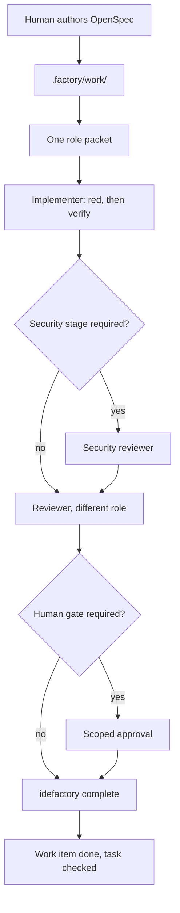
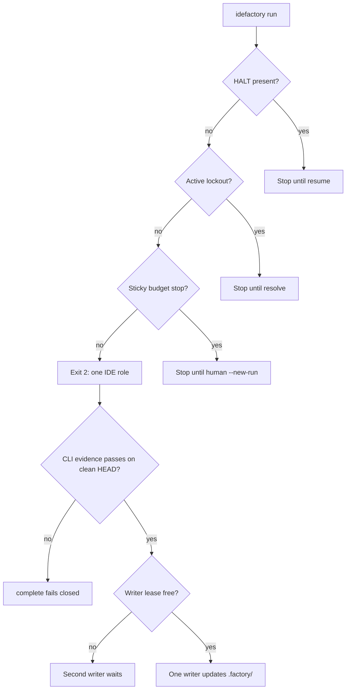

# IDE Factory

A software factory that runs inside Cursor, GitHub Copilot, Claude Code, and Cline. The human defines what to build with [OpenSpec](https://openspec.dev). `.factory/work/` is the only execution queue. Shared team memory lives in `.factory/`. The IDE's own model does the work. The CLI does not launch a model.

## Add it to a project

From a checkout of this repository:

```bash
npm install
npm link

cd /path/to/your-project
idefactory init
idefactory setup
idefactory doctor
```

`init` works in a new directory or an existing repo. It creates `.factory/` and the Cursor, Copilot, Claude, and Cline adapters. It does not delete application files, and it does not copy this repository's GitHub workflows. A second run keeps `decisions.md`, agent histories, charters, and the roster, and it never overwrites a generated adapter file you have edited (see [Upgrading adapters](#upgrading-adapters)). Text already in `AGENTS.md`, `CLAUDE.md`, or `.github/copilot-instructions.md` stays; the factory inserts a marked section. A `.squad/` directory is left untouched.

`idefactory setup` records the test command and the governance mode. The default is lightweight governance: policy version 1 and no principal verifier. In a terminal it asks for the test command and the mode. From a script, pass the answers as flags:

```bash
idefactory setup --governance lightweight --map unit --argv dotnet --argv test
idefactory setup --governance strict --map unit --argv npm --argv test --verifier-argv node --verifier-argv scripts/verify-principal.mjs
idefactory setup --governance lightweight --no-test
idefactory setup --governance lightweight --map unit --argv-json '["dotnet","test","--filter","Category=Unit | Category=Integration"]'
```

`--argv-json` takes the whole command as one JSON array and stores it exactly, which is the safe form for a part that begins with `--` or holds spaces, pipes, or quotes; `--argv=--filter` is the equals form for one such part. Only a command given as a single element that contains whitespace is refused as a shell string. `idefactory checks preview` and `idefactory status` print each registered argv as a JSON array. A flag that needs a value fails rather than storing a placeholder.

`--governance strict` stores policy version 2 and the `--verifier-argv` command. Strict setup writes nothing when that argv is missing. `--no-test` records that the project has no test command. `init` and `upgrade` do not ask these questions; they print the gap and leave an existing registry in place. `idefactory setup --detect` prints proposed commands and writes nothing.

Without a global link:

```bash
node /path/to/ide-factory/src/cli.mjs init --path /path/to/your-project
```

Optional OpenSpec scaffold (uses the OpenSpec CLI via Node; Backlog.md is not required):

```bash
idefactory init --with-openspec
```

`--with-backlog` is ignored (deprecated). The execution queue is `.factory/work/`.

Refresh adapter files after you pull a newer factory, without rewriting decisions or your edits:

```bash
idefactory upgrade
```

## Upgrading adapters

`init` and `upgrade` share one planner. Each generated file is a skill, a command, a rule, an agent file, or a marked section of `AGENTS.md`, `CLAUDE.md`, or `.github/copilot-instructions.md`. For each one the planner compares three things: the file on disk, the rendering this release would write, and the baseline, which is what the factory last wrote. The baseline comes from `.factory/adapters.json`, a committed manifest of content digests (line endings and a trailing newline do not matter). An install that predates the manifest has none, so the planner falls back to a table of every rendering shipped in past releases, `templates/adapter-history.json`.

| Status | Meaning | Action |
| --- | --- | --- |
| `current` | The file already matches this release | None |
| `create` | The file is missing | Written |
| `update` | The file is an unmodified copy of an older release | Replaced |
| `modified` | You edited the file and this release has nothing new for it | Kept, nothing staged |
| `preserved` | You edited the file and this release also changed it | Kept, incoming copy and diff staged |
| `pinned` | You pinned the file with `idefactory adapters pin` | Never touched |
| `malformed` | A marked section in an instruction file has an unpaired, reversed, or repeated marker | Kept, reported |
| `orphan` | A past release generated the file and this one does not | Reported, never deleted |

The safe files are written together. A file in conflict is never overwritten. The command prints one line per file and exits with code 3 when any file is `preserved` or `malformed`. Every other outcome exits 0, so a pipeline can tell "finished with conflicts to review" from a failure. For a `preserved` file the incoming copy and a unified diff are staged under `.factory/upgrade/<timestamp>/` (`incoming/` and `diffs/`; `backups/` holds files that `--replace` or `--force` overwrote). A run with nothing to stage creates no directory, and a repeated run with no change writes nothing.

```bash
idefactory upgrade --dry-run                 # print the plan, write nothing (also on init)
idefactory upgrade --json                    # the same report as one JSON document
idefactory upgrade --replace <path>          # replace this file with the new rendering; the old one is saved under backups/
idefactory upgrade --force                   # replace every preserved file, with backups; a modified file needs --replace
idefactory adapters pin <path>...            # keep this file exactly as it is on every later upgrade
idefactory adapters unpin <path>...
```

`--replace` is repeatable and takes a path. `--force` takes no value; use `--path <dir>` to name the project.

To migrate an install made by an earlier release, run `idefactory upgrade --dry-run`, then `idefactory upgrade`. Unmodified files update. For each preserved file, read the staged diff and either edit the file to match, run `upgrade --replace <path>`, or pin it. Text you already lost to an old overwrite can only be recovered from git.

### Project extensions

To change factory behavior without editing a generated file, put your text in `.factory/extensions/`. `upgrade` inlines it into every generated copy, after the factory text and before the ownership marker, in a section headed `## Project extensions` that names its source file and says that your text wins where it conflicts:

- `.factory/extensions/skills/<skill>.md` goes into all five copies of that skill.
- `.factory/extensions/commands/<command>.md` goes into all four copies of that command.
- `.factory/extensions/rules/factory.md` goes into the Cursor rule, the Copilot agent, and the Cline rule.

Edit or remove an extension and the next `upgrade` rewrites every unmodified copy. A copy you also edited by hand is preserved like any other edit. `init` and `upgrade` never create or write extension files.

## How a change gets built

1. You author an OpenSpec change (`/opsx-propose` or equivalent). The factory will not invent the product for you. `tasks.md` is the human plan.
2. Plan with `/factory-plan`, or run `idefactory sync-tasks <change>`. Each unchecked box becomes one work item under `.factory/work/`. Optional `factory:` YAML under a checkbox sets kind, roles, checks, and dependencies. A task appended later gets its own item, and a checked task that never had an item is ignored. When the task list changes in a way sync cannot match, see "Reconciling a changed task list".
3. Build one item with `/factory-build`, or run a bounded loop with `/factory-run` / `idefactory run --change <name> --until human-gate`. `/factory-full` is explore, then propose if needed, then plan and run. Each step names one role and only that role's charter and history.
4. The implementer records a failing test, then CLI verification evidence. When the work item's security profile is `security-sensitive`, or its checks include a security-patterned kind such as threat-review, sast, secret, or audit, the security reviewer runs before the product reviewer. `verificationProfile` alone does not start that stage. The reviewer is a different role from the implementer.
5. Finalize an accepted attempt with `idefactory complete <change> <id> --attempt <attemptId>`. Completion fails closed unless every required check has a passing CLI record bound to the current clean HEAD, test checks have a recorded red failure, and the reviewer id differs from the implementer. A journal under `.factory/orchestration/finalizations/` lets an interrupted finalization resume without rewriting the plan.



Cursor, Claude, and Copilot slash commands are `/factory-status`, `/factory-plan`, `/factory-build`, `/factory-run`, `/factory-full`, `/factory-review`, and `/factory-setup`. Cline workflows use the filename, for example `/factory-status.md`.

## Gates and stops

`security-sensitive` and `release` profiles ship with `humanGate: true`. The other shipped profiles do not. A missing profile, or a `humanGate` value that is not a boolean, is treated as required. When the gate is required, accept and complete need a scoped approval for that change, task, action (`accept` or `complete`), and clean source revision. The approver is not the implementer, and the approval expires within 24 hours. `idefactory approve` records that decision. It does not publish, deploy, or spend.

The approvable actions are defined once: `accept`, `complete`, `publish`, `deploy`, `spend`, and `account`. The first two are gates bound to a task and revision. The other four are external effects bound to a change and a `--target`. A profile `humanGate` of false never waives an external effect. Before an external-effect step, an agent runs `idefactory authorize --change <name> --action deploy --target staging`. It is read-only and exits zero either way. It reports `authorized`, the approval id, or a `reason` (`no-approval`, `expired`, `revoked`, `revision-mismatch`, `dirty-worktree`, `same-approver`, `policy-mismatch`, `principal-required`, `target-mismatch`) with the approve command a human would run.

```bash
idefactory approve <id> --note "what you are allowing" --change <name> --task <id> --action accept --approver <id> --principal-provider <id> --principal-subject <id> --expiry <iso>
idefactory approve <id> --note "staging deploys" --change <name> --action deploy --target staging --standing --approver <id> --principal-provider <id> --principal-subject <id> --expiry <iso>
idefactory revoke <id> --note "why it ended"
idefactory reject <id> --note "why not"
```

A standing authorization (`--standing`) needs governance policy version 2 and a verified principal, covers one external-effect action for one change and target, and is not tied to a task or revision. Its lifetime is capped by `governance.standingMaxHours` (default 168, from 1 to 720). `idefactory revoke` ends any approval without editing the original record.

### What a run request covers

A human request to run, or to run the full pipeline, for a change covers `sync-tasks`, `run`, `verify`, and `complete` for that change. The installed guidance tells the agent not to ask again before each of them. The cover ends when the run stops and does not reach another change. `approve`, `ci scaffold`, archive, and spec sync each stay a separate human request, and only a human passes `--new-run`. The cover does not waive a profile human gate, a lockout, `HALT`, a run budget stop, or independent review; the CLI enforces those. Before an external effect (publish, deploy, spend, or an account), the agent runs `idefactory authorize` and continues only when it reports `authorized: true`.

### Blocked states

When `run`, `next`, `complete`, `attempt transition`, or `sync-tasks` stops without finishing its step, add `--json` to get a blocked-state report. It names the unmet invariant (`approval-missing`, `no-ready-work`, `attempt-rejected`, `reviewer-lockout`, `red-missing`, `completion-unmet`, `halted`, `reconciliation-required`, and others; `unclassified` when nothing maps), the actor (`human`, `independent-agent`, `implementing-agent`, or `tooling`), the recovery options (each marked `supported` with the command to run, or no supported recovery at all), and a retry class (`safe`, `only-after-change`, `never`). Each option carries an authority: `agent` (the implementing agent may run it), `independent` (an identity other than the implementer runs it), or `human` (a person decides). A person is needed only for the `human` gates, and the installed guidance lists them under `## Blocked states and authority`. Exit codes and the default text do not change. A stop on a work item is also written to `.factory/blocked/<change>--<task>.json` and marked resolved by a later run that finds the condition gone; the record never decides whether work may proceed, and the directory is safe to delete. Packets and run requests list Standing decisions (approvals, standing authorizations, red exceptions, methods, reconciliation decisions) already made for the item, so an agent does not ask for them again. See `idefactory help run`.

### Autonomy report

`idefactory autonomy report [--change <name>] [--since <iso>] [--json]` reads `.factory/observability/events.jsonl` and the closed run sessions under `.factory/orchestration/runs`, and writes nothing. Each stop that needed a human counts once as `policy-decision` (an intentional decision such as a missing approval), `failure` (no supported recovery), or `redundant` (an option an agent may run existed). An approval or a halt resume counts as `policy-decision`; a lockout resolution, a red waiver, or a reconciliation apply is listed under `decisions` instead. Stops handled without a human, autonomous recoveries, and `routineClean` (no `failure` or `redundant` intervention, and every closed session stop recorded) are reported too. It covers what the factory recorded and not prompts typed into an IDE chat. `test/autonomy-acceptance.test.mjs` runs a three-task change with a scripted agent against it. `docs/cloud-acceptance.md` is the runbook a cloud integration must pass; records live in `docs/acceptance/`.

A reviewer rejection records an immutable lockout. `run` and `complete` stop while one is active. Resolve it with a resolver who is not the locked agent. Repeating the same resolution is safe. A conflicting resolution fails.

```bash
idefactory lockout create --agent <implementer-id> --reviewer reviewer --reason "what failed"
idefactory lockout resolve <id> --resolver <id> --reason "what changed"
```

`--agent`, `--reviewer`, and `--resolver` take the same identities as attempt evidence, so an id such as `engineer-5.1-abc123` works. `--reviewer` is required. An id outside that format is accepted only when an attempt already records it exactly.

`HALT` in the project root stops mutating factory commands. `idefactory resume` clears it.

`idefactory run` persists a session for the change. Exit `2` means one IDE role should take the printed request. Exit `0` is a clean stop: the queue is done, a human gate is waiting, or a budget stop was reached. Exit `1` is an error such as an active lockout, a rejected attempt, or a blocked dependency. Sticky stops, including max agent steps, max tasks, wall-clock, max failures, and unchanged state, stay in force until a human starts a new session:

```bash
idefactory run --change <name> --new-run
```

Mutating commands take a single writer lease at `.factory/orchestration/writer.lease`. A second writer is told the lease is held. `status`, `doctor`, and `attempt show` do not take it.

`idefactory verify run <attemptId> --check <kind>` stores the check result from the registry command. Completion does not accept a pass/fail flag supplied on the transition.

### Reusing passing checks

A passing `verify run` record stays valid across commits that change only factory run-state, such as attempts, the work queue, observability, and orchestration files under `.factory/`. Any other change since the record makes it stale, and the reason names the first changed path. A changed registry entry, timeout, or `.factory/checks.json` also makes it stale. Review handoff, `complete`, and the security gate use this one rule.

`idefactory requirements <change> <task>` prints the one resolved requirement set for a work item: each required check with its source (profile, item, or both), the test kinds that need a red, the human decisions it will need, its dependencies, and any problems. Add `--json` for one document with `schemaVersion` 1. It is read-only. The packet, the run request, the gate into `verifying`, red exceptions, the review handoff, and completion all read that set, so a check a profile adds is visible, and gated, before implementation. An attempt does not start while the set has a problem (an undefined profile, a required kind with no registered argv, a human gate the policy cannot satisfy, or a missing dependency), and `sync-tasks` prints the same problems as warnings. Completion and the review handoff report every unmet check and red together.

`idefactory verify status <attemptId>` shows each required check as `valid`, `stale`, `missing`, `failed`, or `untrusted`, with the reason. Add `--json` for one document with `schemaVersion` 1 and `allValid`. It is read-only and exits zero even when a check is not valid.

Records written before this release carry no reuse fingerprint, so they are stale with the reason `re-run verify`. After upgrading, run `idefactory verify run <attemptId> --check <kind>` once for each check that is stale.

### Transition evidence

`idefactory attempt transition <attemptId> <state>` takes its evidence JSON from one of two flags. Give only one.

- `--evidence <json>` takes inline JSON.
- `--evidence-file <path>` takes the path of a file that holds a JSON object. It never takes inline JSON. A relative path resolves from the current directory. The file is read as UTF-8, and a UTF-8 byte-order mark or a UTF-16LE file with a byte-order mark is also accepted. The CLI does not modify or delete the file.

Evidence may contain only these keys. The review text goes in the top-level `notes` key, not nested under `review`:

- `reviewerId`, `implementerId`, and `securityReviewerId` are identities: 1 to 128 characters from letters, digits, `.`, `_`, `@`, `:`, `+`, and `-`, starting with a letter or digit. Any other value is refused before the attempt changes.
- `verdict` is a string. A reviewer's `accepted` or `rejected` transition refuses a verdict that contradicts it; omit `verdict` or send the matching one.
- `notes` is a string. It is stored as the review notes for a reviewer's accept or reject.
- `changedFiles` is an array of strings, and `baseRev` is a string.

Any other key, or a value of the wrong type, fails with an error that names it, and the attempt file is not changed. For example, `{"reviewerId":"reviewer-1","review":{"notes":"..."}}` fails with `unsupported evidence key "review"; put review text in top-level "notes"`.

Windows PowerShell 5.1 strips the quotation marks from JSON passed as a native command argument, which produces `Expected property name or '}' in JSON`. Use the file flag there, and anywhere else you want to avoid shell quoting. Write the file to the operating system temporary directory, not inside the project, because an untracked file in the project makes the worktree dirty and blocks verification and completion. Remove it afterward whether the command succeeds or fails:

```powershell
$file = Join-Path ([IO.Path]::GetTempPath()) "evidence-$([guid]::NewGuid()).json"
try {
  Set-Content -Path $file -Encoding UTF8 -Value '{"reviewerId":"reviewer-1","verdict":"ACCEPT","notes":"looks good"}'
  idefactory attempt transition <attemptId> accepted --evidence-file $file
} finally {
  Remove-Item -Path $file -ErrorAction SilentlyContinue
}
```

### Red method

Test-first is the default method (`red-first`). When a failing test cannot specify the change, the implementing agent records a `no-red` method before editing begins, with no human approval:

```bash
idefactory method propose <attemptId> --choice no-red --reason configuration --rationale "only a config value changes" --implementer <id> --kind unit
idefactory method review <attemptId> --verdict ACCEPT --reviewer <id> --note "config-only diff"
```

The reason class is one of `docs-or-text`, `configuration`, `behavior-preserving`, `mechanical`, or `exploratory`; `behavior-preserving` must cite an existing git-tracked test with `--test-path`. The record keeps the source revision and the number of changed files. A different role must record `method review`, and the attempt cannot be accepted without an `ACCEPT`; after a `REJECT` the item uses `red-first`. A method covers only its kinds, is never shown as a red that ran or as an exception, and does not waive passing verification, independent review, lockouts, or human gates. A proposal is refused when the work item has an explicit `factory.taskType`. `idefactory method show <attemptId>` prints the record.

### Reconciling a changed task list

`sync-tasks` fails closed when an edit splits, merges, removes, or reorders tasks, or adds a task together with a reword, and the error names the plan command. `idefactory sync-tasks <change> --plan [--json]` prints, without writing anything, the automatic actions, each unmatched stored item and current task, items with an attempt and its state, classification drift (old and new requirement sets), dependents of items that would be held, other active changes whose capability deltas overlap, and a plan digest.

`idefactory sync-tasks <change> --apply --decisions-file <path> --plan-digest <digest> --decided-by <id>` applies explicit decisions. The file is a JSON object keyed by stored item id, each value a decision name or an object: `keep`, `renumber` (`{"to":"1.4"}`), `defer`, `resume`, `drop` (`{"supersededBy":["1.5"],"dependents":"block|release"}`), `split` (`{"into":["1.4","1.5"]}`), `merge` (`{"into":"1.3"}`), `move` (`{"to":{"change":"other","id":"2.1"}}`), `adopt-classification`, and `keep-classification`. Nothing is inferred from text similarity, and a stale digest, a missing decision, or a conflicting file changes nothing.

A wording change on an item that has an attempt updates its title and keeps the earlier text in `titleHistory`; its classification, dependencies, and acceptance criteria are never rewritten silently, and a difference is reported as drift. Deferred and dropped items are stored as `blocked` with a `hold` marker, keep their attempts and evidence, are never selected by `next` or `run`, and cannot be completed; `status` lists them. `adopt-classification`, `drop`, `split`, `merge`, and `move` on an item with an attempt past `planned` need a `--decided-by` identity other than the implementer, and under governance policy version 2 a verified principal. Each apply writes a record under `.factory/work/reconciliations/`, appends a `tasks.reconciled` event, and is idempotent for the same digest and decisions. Renumbering writes the new item files before removing old ones and finishes after a crash.

### Red exceptions

A `code` item needs a recorded failing CLI red before it can move to `verifying`. When a rejected attempt held a genuine red and its replacement already passes, the replacement stops with `vacuous-red` and no new red can run. When a stored red is not genuine, `idefactory red invalidate` withdraws it. Only when neither fits, an audited exception is available, and each command needs an approver other than the implementer (the `independent` gates `reuse-red` and `waive-red`):

```bash
idefactory red reuse <targetAttemptId> --from <sourceAttemptId> --kind unit --note "verification-only retry" --approver <human>
idefactory red waive <targetAttemptId> --kind unit --note "reason" --approver <human>
```

`red reuse` binds the rejected attempt's red to the replacement by digest. It needs a clean HEAD, a passing CLI verification on that HEAD, and an approver who is not the implementer. `red waive` records that no red exists. Waiving a red before the system is stuck is discouraged. The command refuses until the attempt has hit `vacuous-red` for that kind, and it proceeds earlier only when the human repeats it with `--acknowledge-not-stuck`. Neither command writes `evidence.reds`, and neither waives clean-revision verification, independent review, or lockouts. Status, the reviewer packet, and the verdict comment say that no red ran and name the exception, approver, and reason.

### Reopening an accepted attempt

Completion can find a required red missing on an attempt that was already accepted, for example when a profile added a check after acceptance. `idefactory attempt reopen <attemptId> --kind <kind> --for method|exception --by <id> --reason "text"` moves the attempt back to `awaiting-review` for the named kinds without editing evidence. The identity must differ from the implementer, and under governance policy version 2 it must equal a verified principal. An attempt can be reopened at most twice, never after finalization starts or when a finalization journal exists, and only for kinds that have no satisfying red, method, or exception. The earlier review moves to `evidence.reviewHistory` and does not count; every stored red, verification, and exception record is unchanged. While reopened, `red reuse`, `red waive`, and `method propose` accept only the named kinds, a waiver for a reopened kind needs no `--acknowledge-not-stuck`, and a reviewer must accept the amended attempt again. Status, the reviewer packet, the review request, and the verdict comment show each reopen with the earlier verdict. `attempt transition` still refuses `accepted` to `awaiting-review`.

A failing red recorded after implementation is not test-first evidence, and the CLI cannot detect one. A human can invalidate it on the same attempt with `--invalid-red "reason"` and `--acknowledge-not-stuck`. `red waive` then refuses any failing red it has not been told to invalidate. The invalidated red does not satisfy red; the reviewer packet, status, and verdict comment name its digest and reason. A waiver does not replace passing verification, independent review, or lockouts.

Red records are append-only. Every `verify run --red` for a kind is kept in `evidence.redHistory[kind]`, `evidence.reds[kind]` stays the current (latest) red, and an attempt stored without a history reads as one entry per red. `idefactory red list <attemptId> [--json]` is read-only and prints each red with its digest, the current marker, the exception that references it, and what satisfies red for the kind. After an invalid-red waiver, `verify run --red` is allowed once more for that kind; the later red satisfies red only when it is a failing CLI red that started after the waiver and the invalidated digest is still in the history. A kind can be invalidated once on an attempt. Reuse and ordinary waivers still refuse `--red`. Status, the reviewer packet, and the verdict comment show both digests and say the later red does not prove the test came first.



## Commands

| Command | What it does |
| --- | --- |
| `idefactory init` | Install `.factory/` and IDE adapters |
| `idefactory setup` | Record the test command and lightweight or strict governance |
| `idefactory upgrade` | Refresh unmodified generated adapters, keep your edits, and report conflicts (exit 3). Takes `--dry-run`, `--json`, `--replace <path>`, `--force` |
| `idefactory adapters pin <path>` | Keep a generated file as it is on every upgrade. `unpin` reverses it |
| `idefactory doctor` | Fail if required team state or adapter files are missing |
| `idefactory status` | Show halt, the active change, the roster, and work queue counts |
| `idefactory sync-tasks <change>` | Create work items from unchecked OpenSpec boxes |
| `idefactory next` | Print one role-scoped work packet. Does not launch a model |
| `idefactory run` | Resume the persisted run and print the next request or stop reason |
| `idefactory attempt …` | Start, transition, reopen, or show an execution attempt |
| `idefactory verify run` | Run a registered check and store CLI evidence |
| `idefactory verify status` | Report each required check as valid, stale, missing, failed, or untrusted. Read-only |
| `idefactory red reuse` / `waive` | Record an audited red exception for a verification-only retry. Does not write a red |
| `idefactory red list` | List every recorded red with its digest and what satisfies red. Read-only |
| `idefactory complete` | Journal the finalization and mark an accepted attempt done |
| `idefactory approve` / `reject` | Record a human decision. Does not publish or spend |
| `idefactory lockout` | Create or resolve a reviewer lockout |
| `idefactory halt` / `resume` | Set or clear the kill switch |
| `idefactory forge configure` | Choose `github` (default) or `azure-devops` for `idefactory pr` |
| `idefactory board …` | Optional Azure DevOps board mirror: `configure`, `publish`, `claim`, `report`, `comment`, `transition` |
| `idefactory mcp ack` / `record` / `pending` | Record a plan the agent applied through the Azure DevOps MCP, record the agent's decision about a failed operation, or list pending plans with each operation's outcome and retry count |
| `idefactory help <command>` | Print usage, flags, and examples for one command. Also `idefactory <command> --help`, `-h`, and `help --json` |

### Contextual help

`idefactory help` prints the full usage list. For one command, run `idefactory help <command>`, `idefactory <command> --help`, or `idefactory <command> -h`. The help names the usage line, arguments, flags, examples, and whether the command writes project state. A command group such as `attempt`, `verify`, `red`, `pr`, `adapters`, `ci`, or `lockout` lists its subcommands. `idefactory help attempt transition` also lists every attempt state, the transitions each state allows, the evidence keys with their types, and what each state needs before an attempt can enter it.

Add `--json` for structured help: `idefactory help verify run --json` prints one JSON document with `schemaVersion` 1, and `idefactory help --json` lists every command. Help is read-only. It needs no project, takes no writer lease, and works while `HALT` exists. An unknown topic, as in `idefactory help attempt transitoin`, exits 1 and lists the valid names. The installed factory skills point agents to this help instead of the CLI source.

## Cloud runs from an Azure DevOps board

Local use is the default and needs none of this. With no `board` entry in `.factory/config.json`, every `board` command refuses and nothing talks to Azure DevOps.

`idefactory` never contacts Azure DevOps with the default `mcp` transport, so no Azure DevOps secret is on the VM. A command that would write prints a plan: numbered operations for Cursor's Azure DevOps MCP connection, each a tool name and a full argument object. The cloud agent calls them exactly as printed and then runs `idefactory mcp ack <planId>`, and only then does the CLI record the result in `.factory/boards/` or `.factory/pull-requests/`. Reads go the other way: the agent saves the MCP result to a file in the temporary directory and passes it with `board claim --snapshot` or `pr capture --threads-file`. Plans name only these tools: `wit_work_item_write`, `wit_work_item_comment_write`, `wit_work_item_link_write`, `repo_pull_request_write` (create, or update the description), and `repo_pull_request_thread_write`. The plan builder refuses `autoComplete`, `bypassReason`, `vote`, `status`, and the other completion arguments. A claim's state change starts with a `Test` of the story revision, so two cloud runs cannot both claim one story. The MCP cannot push commits, so the cloud agent pushes `factory/<change>` with its own git access.

When an operation fails, the agent judges the cause and records its decision with `idefactory mcp record`. The CLI refuses a retry that could repeat an effect the read-back shows already landed, and it caps retries per operation at `mcp.maxOperationAttempts` (default 3). Past the cap, the refusal is a blocked report for a human. `mcp ack` refuses while an operation's latest outcome is failed or unknown.

To let the factory pick up work by itself:

1. A human authors an OpenSpec change, runs `idefactory sync-tasks <change>` and `idefactory board publish <change>`, and pushes. Publish creates one User Story per change, tagged `factory`, with `Custom.OpenSpecChange` set to the change name.
2. Moving that story to `Ready for Factory` is the request. An Azure DevOps service hook posts to the reference filter in [`tools/ado-bridge/`](tools/ado-bridge/README.md), which forwards only that transition to a Cursor Automation webhook.
3. The Automation's cloud agent follows the `factory-cloud` skill. `idefactory board claim` decides `start`, `resume`, `skip`, `duplicate`, `not-ready`, or `halted`, so a repeated delivery does not run twice.
4. The agent runs `idefactory run --until human-gate` on `factory/<change>`, mirrors progress with `idefactory board report`, and opens the pull request with `idefactory pr open`.
5. A gate, lockout, or rejected review moves the story to `Waiting on Human` or `Blocked`. The human decides, then moves the story back to `Ready for Factory` to resume.

The agent never merges, never approves, never clears `HALT`, and never moves a story to the ready state or a done state. The CLI cannot prove the agent applied a plan or read a story honestly, so enforce the gates in Azure DevOps too: the identity behind the MCP connection should not hold "Bypass policies when completing pull requests" or "Bypass policies when pushing", and `main` should require a reviewer and block self-approval. `--transport az` on `board configure` and `forge configure` keeps the Azure CLI path for use outside a cloud agent: it needs `az` with the `azure-devops` extension and the runtime secret `ADO_TOKEN`, which reaches the CLI only as `AZURE_DEVOPS_EXT_PAT` in its environment, never on argv. `idefactory` itself never launches a model and never polls the board.

## What gets installed

```text
.factory/                  roster, routing, decisions, governance, work queue, attempts, profiles
.cursor/skills/factory-*   Cursor skills
.cursor/commands/factory-* Cursor slash commands
.cursor/rules/factory.mdc  always in context; factory work only when you ask
.github/agents/factory.agent.md
.github/prompts/factory-*.prompt.md
.github/skills/factory-*
.claude/skills/factory-*
.claude/commands/factory-*
.agents/skills/factory-*
.cline/rules/factory.md    Cline rule; unrelated requests stay alone
.cline/skills/<name>/      the same factory skills
.cline/workflows/factory-*.md
```

Cline files are installed only under `.cline/`. The older `.clinerules/` tree is not written. Operational baseline lives in `.factory/governance.md`.

## This repository's CI

These workflows live in this repository. `idefactory init` does not copy them into adopting projects.

On pull request and push, the `baseline` job uses Node 24 and runs `npm ci`, `npm test`, `npm audit --audit-level=high`, and `npx openspec validate --all`. A separate secret-scan job runs secretlint. The `sast` job uses Python 3.14, installs pinned Semgrep on the runner immediately before `node scripts/run-semgrep.mjs`, and fails if that scan cannot run. `npm test` does not download Semgrep.

On a `vX.Y.Z` tag, the release workflow uses Node 24, writes a CycloneDX SBOM from the lockfile, and attests that SBOM with `actions/attest-build-provenance` (SLSA provenance v1). It does not claim SLSA Build L2 or L3.

`.github/branch-review-controls.json` declares the `baseline` check, one approving review, and no force-push on `main`. GitHub does not enforce that declaration until an admin enables the ruleset.

## Develop

```bash
npm install
npm test
```

Local engines are Node.js 20 or newer. This repository's CI uses Node 24 and, for the Semgrep install, Python 3.14. Behavior specs are in `openspec/specs/`. Change proposals are in `openspec/changes/`.
