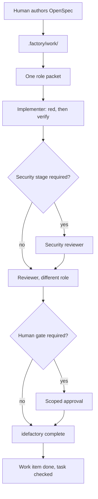
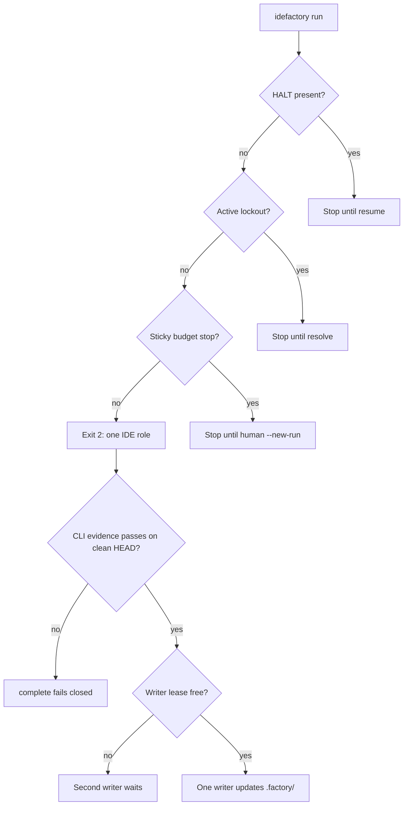

# IDE Factory

A software factory that runs inside Cursor, GitHub Copilot, Claude Code, and Cline. The human defines what to build with [OpenSpec](https://openspec.dev). `.factory/work/` is the only execution queue. Shared team memory lives in `.factory/`. The IDE's own model does the work. The CLI does not launch a model.

## Add it to a project

From a checkout of this repository:

```bash
npm install
npm link

cd /path/to/your-project
idefactory init
idefactory doctor
```

`init` works in a new directory or an existing repo. It creates `.factory/` and the Cursor, Copilot, Claude, and Cline adapters. It does not delete application files, and it does not copy this repository's GitHub workflows. A second run keeps `decisions.md`, agent histories, charters, and the roster. Text already in `AGENTS.md`, `CLAUDE.md`, or `.github/copilot-instructions.md` stays; the factory inserts a marked section. A `.squad/` directory is left untouched.

Without a global link:

```bash
node /path/to/ide-factory/src/cli.mjs init --path /path/to/your-project
```

Optional OpenSpec scaffold (uses the OpenSpec CLI via Node; Backlog.md is not required):

```bash
idefactory init --with-openspec
```

`--with-backlog` is ignored (deprecated). The execution queue is `.factory/work/`.

Refresh adapter files after you pull a newer factory, without rewriting decisions:

```bash
idefactory upgrade
```

## How a change gets built

1. You author an OpenSpec change (`/opsx-propose` or equivalent). The factory will not invent the product for you. `tasks.md` is the human plan.
2. Plan with `/factory-plan`, or run `idefactory sync-tasks <change>`. Each unchecked box becomes one work item under `.factory/work/`. Optional `factory:` YAML under a checkbox sets kind, roles, checks, and dependencies.
3. Build one item with `/factory-build`, or run a bounded loop with `/factory-run` / `idefactory run --change <name> --until human-gate`. `/factory-full` is explore, then propose if needed, then plan and run. Each step names one role and only that role's charter and history.
4. The implementer records a failing test, then CLI verification evidence. When the work item's security profile is `security-sensitive`, or its checks include a security-patterned kind such as threat-review, sast, secret, or audit, the security reviewer runs before the product reviewer. `verificationProfile` alone does not start that stage. The reviewer is a different role from the implementer.
5. Finalize an accepted attempt with `idefactory complete <change> <id> --attempt <attemptId>`. Completion fails closed unless every required check has a passing CLI record bound to the current clean HEAD, test checks have a recorded red failure, and the reviewer id differs from the implementer. A journal under `.factory/orchestration/finalizations/` lets an interrupted finalization resume without rewriting the plan.



Cursor, Claude, and Copilot slash commands are `/factory-status`, `/factory-plan`, `/factory-build`, `/factory-run`, `/factory-full`, and `/factory-review`. Cline workflows use the filename, for example `/factory-status.md`.

## Gates and stops

`security-sensitive` and `release` profiles ship with `humanGate: true`. The other shipped profiles do not. A missing profile, or a `humanGate` value that is not a boolean, is treated as required. When the gate is required, accept and complete need a scoped approval for that change, task, action (`accept` or `complete`), and clean source revision. The approver is not the implementer, and the approval expires within 24 hours. `idefactory approve` records that decision. It does not publish, deploy, or spend.

```bash
idefactory approve <id> --note "what you are allowing" --change <name> --task <id> --action accept --approver <id> --expiry <iso>
idefactory reject <id> --note "why not"
```

A reviewer rejection records an immutable lockout. `run` and `complete` stop while one is active. Resolve it with a resolver who is not the locked agent. Repeating the same resolution is safe. A conflicting resolution fails.

```bash
idefactory lockout create --agent <implementer-id> --reviewer reviewer --reason "what failed"
idefactory lockout resolve <id> --resolver <id> --reason "what changed"
```

`HALT` in the project root stops mutating factory commands. `idefactory resume` clears it.

`idefactory run` persists a session for the change. Exit `2` means one IDE role should take the printed request. Exit `0` is a clean stop: the queue is done, a human gate is waiting, or a budget stop was reached. Exit `1` is an error such as an active lockout, a rejected attempt, or a blocked dependency. Sticky stops, including max agent steps, max tasks, wall-clock, max failures, and unchanged state, stay in force until a human starts a new session:

```bash
idefactory run --change <name> --new-run
```

Mutating commands take a single writer lease at `.factory/orchestration/writer.lease`. A second writer is told the lease is held. `status`, `doctor`, and `attempt show` do not take it.

`idefactory verify run <attemptId> --check <kind>` stores the check result from the registry command. Completion does not accept a pass/fail flag supplied on the transition.



## Commands

| Command | What it does |
| --- | --- |
| `idefactory init` | Install `.factory/` and IDE adapters |
| `idefactory upgrade` | Refresh factory-owned skills, commands, rules, and workflows |
| `idefactory doctor` | Fail if required team state or adapter files are missing |
| `idefactory status` | Show halt, the active change, the roster, and work queue counts |
| `idefactory sync-tasks <change>` | Create work items from unchecked OpenSpec boxes |
| `idefactory next` | Print one role-scoped work packet. Does not launch a model |
| `idefactory run` | Resume the persisted run and print the next request or stop reason |
| `idefactory attempt …` | Start, transition, or show an execution attempt |
| `idefactory verify run` | Run a registered check and store CLI evidence |
| `idefactory complete` | Journal the finalization and mark an accepted attempt done |
| `idefactory approve` / `reject` | Record a human decision. Does not publish or spend |
| `idefactory lockout` | Create or resolve a reviewer lockout |
| `idefactory halt` / `resume` | Set or clear the kill switch |

## What gets installed

```text
.factory/                  roster, routing, decisions, governance, work queue, attempts, profiles
.cursor/skills/factory-*   Cursor skills
.cursor/commands/factory-* Cursor slash commands
.cursor/rules/factory.mdc  always in context; factory work only when you ask
.github/agents/factory.agent.md
.github/prompts/factory-*.prompt.md
.github/skills/factory-*
.claude/skills/factory-*
.claude/commands/factory-*
.agents/skills/factory-*
.cline/rules/factory.md    Cline rule; unrelated requests stay alone
.cline/skills/<name>/      the same factory skills
.cline/workflows/factory-*.md
```

Cline files are installed only under `.cline/`. The older `.clinerules/` tree is not written. Operational baseline lives in `.factory/governance.md`.

## This repository's CI

These workflows live in this repository. `idefactory init` does not copy them into adopting projects.

On pull request and push, the `baseline` job uses Node 24 and runs `npm ci`, `npm test`, `npm audit --audit-level=high`, and `npx openspec validate --all`. A separate secret-scan job runs secretlint. The `sast` job uses Python 3.14, installs pinned Semgrep on the runner immediately before `node scripts/run-semgrep.mjs`, and fails if that scan cannot run. `npm test` does not download Semgrep.

On a `vX.Y.Z` tag, the release workflow uses Node 24, writes a CycloneDX SBOM from the lockfile, and attests that SBOM with `actions/attest-build-provenance` (SLSA provenance v1). It does not claim SLSA Build L2 or L3.

`.github/branch-review-controls.json` declares the `baseline` check, one approving review, and no force-push on `main`. GitHub does not enforce that declaration until an admin enables the ruleset.

## Develop

```bash
npm install
npm test
```

Local engines are Node.js 20 or newer. This repository's CI uses Node 24 and, for the Semgrep install, Python 3.14. Behavior specs are in `openspec/specs/`. Change proposals are in `openspec/changes/`.
