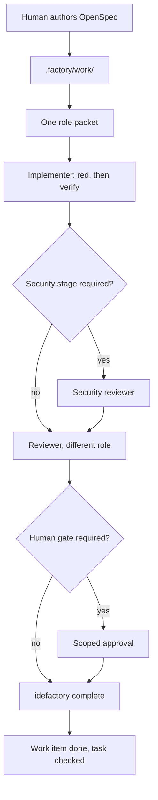
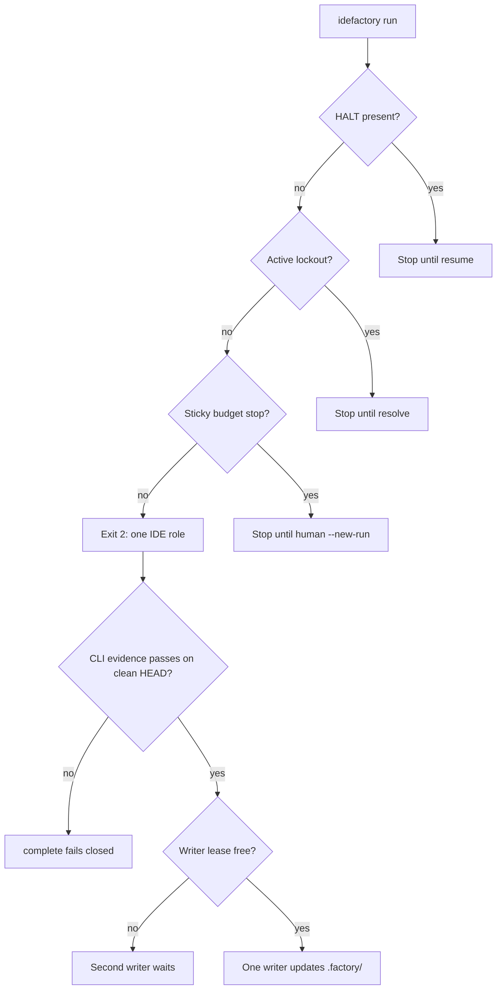

# IDE Factory

A software factory that runs inside Cursor, GitHub Copilot, Claude Code, and Cline. The human defines what to build with [OpenSpec](https://openspec.dev). `.factory/work/` is the only execution queue. Shared team memory lives in `.factory/`. The IDE's own model does the work. The CLI does not launch a model.

## Add it to a project

From a checkout of this repository:

```bash
npm install
npm link

cd /path/to/your-project
idefactory init
idefactory setup
idefactory doctor
```

`init` works in a new directory or an existing repo. It creates `.factory/` and the Cursor, Copilot, Claude, and Cline adapters. It does not delete application files, and it does not copy this repository's GitHub workflows. A second run keeps `decisions.md`, agent histories, charters, and the roster, and it never overwrites a generated adapter file you have edited (see [Upgrading adapters](#upgrading-adapters)). Text already in `AGENTS.md`, `CLAUDE.md`, or `.github/copilot-instructions.md` stays; the factory inserts a marked section. A `.squad/` directory is left untouched.

`idefactory setup` records the test command and the governance mode. The default is lightweight governance: policy version 1 and no principal verifier. In a terminal it asks for the test command and the mode. From a script, pass the answers as flags:

```bash
idefactory setup --governance lightweight --map unit --argv dotnet --argv test
idefactory setup --governance strict --map unit --argv npm --argv test --verifier-argv node --verifier-argv scripts/verify-principal.mjs
idefactory setup --governance lightweight --no-test
```

`--governance strict` stores policy version 2 and the `--verifier-argv` command. Strict setup writes nothing when that argv is missing. `--no-test` records that the project has no test command. `init` and `upgrade` do not ask these questions; they print the gap and leave an existing registry in place. `idefactory setup --detect` prints proposed commands and writes nothing.

Without a global link:

```bash
node /path/to/ide-factory/src/cli.mjs init --path /path/to/your-project
```

Optional OpenSpec scaffold (uses the OpenSpec CLI via Node; Backlog.md is not required):

```bash
idefactory init --with-openspec
```

`--with-backlog` is ignored (deprecated). The execution queue is `.factory/work/`.

Refresh adapter files after you pull a newer factory, without rewriting decisions or your edits:

```bash
idefactory upgrade
```

## Upgrading adapters

`init` and `upgrade` share one planner. Each generated file is a skill, a command, a rule, an agent file, or a marked section of `AGENTS.md`, `CLAUDE.md`, or `.github/copilot-instructions.md`. For each one the planner compares three things: the file on disk, the rendering this release would write, and the baseline, which is what the factory last wrote. The baseline comes from `.factory/adapters.json`, a committed manifest of content digests (line endings and a trailing newline do not matter). An install that predates the manifest has none, so the planner falls back to a table of every rendering shipped in past releases, `templates/adapter-history.json`.

| Status | Meaning | Action |
| --- | --- | --- |
| `current` | The file already matches this release | None |
| `create` | The file is missing | Written |
| `update` | The file is an unmodified copy of an older release | Replaced |
| `modified` | You edited the file and this release has nothing new for it | Kept, nothing staged |
| `preserved` | You edited the file and this release also changed it | Kept, incoming copy and diff staged |
| `pinned` | You pinned the file with `idefactory adapters pin` | Never touched |
| `malformed` | A marked section in an instruction file has an unpaired, reversed, or repeated marker | Kept, reported |
| `orphan` | A past release generated the file and this one does not | Reported, never deleted |

The safe files are written together. A file in conflict is never overwritten. The command prints one line per file and exits with code 3 when any file is `preserved` or `malformed`. Every other outcome exits 0, so a pipeline can tell "finished with conflicts to review" from a failure. For a `preserved` file the incoming copy and a unified diff are staged under `.factory/upgrade/<timestamp>/` (`incoming/` and `diffs/`; `backups/` holds files that `--replace` or `--force` overwrote). A run with nothing to stage creates no directory, and a repeated run with no change writes nothing.

```bash
idefactory upgrade --dry-run                 # print the plan, write nothing (also on init)
idefactory upgrade --json                    # the same report as one JSON document
idefactory upgrade --replace <path>          # replace this file with the new rendering; the old one is saved under backups/
idefactory upgrade --force                   # replace every preserved file, with backups; a modified file needs --replace
idefactory adapters pin <path>...            # keep this file exactly as it is on every later upgrade
idefactory adapters unpin <path>...
```

`--replace` is repeatable and takes a path. `--force` takes no value; use `--path <dir>` to name the project.

To migrate an install made by an earlier release, run `idefactory upgrade --dry-run`, then `idefactory upgrade`. Unmodified files update. For each preserved file, read the staged diff and either edit the file to match, run `upgrade --replace <path>`, or pin it. Text you already lost to an old overwrite can only be recovered from git.

### Project extensions

To change factory behavior without editing a generated file, put your text in `.factory/extensions/`. `upgrade` inlines it into every generated copy, after the factory text and before the ownership marker, in a section headed `## Project extensions` that names its source file and says that your text wins where it conflicts:

- `.factory/extensions/skills/<skill>.md` goes into all five copies of that skill.
- `.factory/extensions/commands/<command>.md` goes into all four copies of that command.
- `.factory/extensions/rules/factory.md` goes into the Cursor rule, the Copilot agent, and the Cline rule.

Edit or remove an extension and the next `upgrade` rewrites every unmodified copy. A copy you also edited by hand is preserved like any other edit. `init` and `upgrade` never create or write extension files.

## How a change gets built

1. You author an OpenSpec change (`/opsx-propose` or equivalent). The factory will not invent the product for you. `tasks.md` is the human plan.
2. Plan with `/factory-plan`, or run `idefactory sync-tasks <change>`. Each unchecked box becomes one work item under `.factory/work/`. Optional `factory:` YAML under a checkbox sets kind, roles, checks, and dependencies.
3. Build one item with `/factory-build`, or run a bounded loop with `/factory-run` / `idefactory run --change <name> --until human-gate`. `/factory-full` is explore, then propose if needed, then plan and run. Each step names one role and only that role's charter and history.
4. The implementer records a failing test, then CLI verification evidence. When the work item's security profile is `security-sensitive`, or its checks include a security-patterned kind such as threat-review, sast, secret, or audit, the security reviewer runs before the product reviewer. `verificationProfile` alone does not start that stage. The reviewer is a different role from the implementer.
5. Finalize an accepted attempt with `idefactory complete <change> <id> --attempt <attemptId>`. Completion fails closed unless every required check has a passing CLI record bound to the current clean HEAD, test checks have a recorded red failure, and the reviewer id differs from the implementer. A journal under `.factory/orchestration/finalizations/` lets an interrupted finalization resume without rewriting the plan.



Cursor, Claude, and Copilot slash commands are `/factory-status`, `/factory-plan`, `/factory-build`, `/factory-run`, `/factory-full`, `/factory-review`, and `/factory-setup`. Cline workflows use the filename, for example `/factory-status.md`.

## Gates and stops

`security-sensitive` and `release` profiles ship with `humanGate: true`. The other shipped profiles do not. A missing profile, or a `humanGate` value that is not a boolean, is treated as required. When the gate is required, accept and complete need a scoped approval for that change, task, action (`accept` or `complete`), and clean source revision. The approver is not the implementer, and the approval expires within 24 hours. `idefactory approve` records that decision. It does not publish, deploy, or spend.

```bash
idefactory approve <id> --note "what you are allowing" --change <name> --task <id> --action accept --approver <id> --principal-provider <id> --principal-subject <id> --expiry <iso>
idefactory reject <id> --note "why not"
```

A reviewer rejection records an immutable lockout. `run` and `complete` stop while one is active. Resolve it with a resolver who is not the locked agent. Repeating the same resolution is safe. A conflicting resolution fails.

```bash
idefactory lockout create --agent <implementer-id> --reviewer reviewer --reason "what failed"
idefactory lockout resolve <id> --resolver <id> --reason "what changed"
```

`HALT` in the project root stops mutating factory commands. `idefactory resume` clears it.

`idefactory run` persists a session for the change. Exit `2` means one IDE role should take the printed request. Exit `0` is a clean stop: the queue is done, a human gate is waiting, or a budget stop was reached. Exit `1` is an error such as an active lockout, a rejected attempt, or a blocked dependency. Sticky stops, including max agent steps, max tasks, wall-clock, max failures, and unchanged state, stay in force until a human starts a new session:

```bash
idefactory run --change <name> --new-run
```

Mutating commands take a single writer lease at `.factory/orchestration/writer.lease`. A second writer is told the lease is held. `status`, `doctor`, and `attempt show` do not take it.

`idefactory verify run <attemptId> --check <kind>` stores the check result from the registry command. Completion does not accept a pass/fail flag supplied on the transition.

### Transition evidence

`idefactory attempt transition <attemptId> <state>` takes its evidence JSON from one of two flags. Give only one.

- `--evidence <json>` takes inline JSON.
- `--evidence-file <path>` takes the path of a file that holds a JSON object. It never takes inline JSON. A relative path resolves from the current directory. The file is read as UTF-8, and a UTF-8 byte-order mark or a UTF-16LE file with a byte-order mark is also accepted. The CLI does not modify or delete the file.

Evidence may contain only these keys. The review text goes in the top-level `notes` key, not nested under `review`:

- `reviewerId`, `implementerId`, and `securityReviewerId` are strings.
- `verdict` is a string. A reviewer's `accepted` or `rejected` transition refuses a verdict that contradicts it; omit `verdict` or send the matching one.
- `notes` is a string. It is stored as the review notes for a reviewer's accept or reject.
- `changedFiles` is an array of strings, and `baseRev` is a string.

Any other key, or a value of the wrong type, fails with an error that names it, and the attempt file is not changed. For example, `{"reviewerId":"reviewer-1","review":{"notes":"..."}}` fails with `unsupported evidence key "review"; put review text in top-level "notes"`.

Windows PowerShell 5.1 strips the quotation marks from JSON passed as a native command argument, which produces `Expected property name or '}' in JSON`. Use the file flag there, and anywhere else you want to avoid shell quoting. Write the file to the operating system temporary directory, not inside the project, because an untracked file in the project makes the worktree dirty and blocks verification and completion. Remove it afterward whether the command succeeds or fails:

```powershell
$file = Join-Path ([IO.Path]::GetTempPath()) "evidence-$([guid]::NewGuid()).json"
try {
  Set-Content -Path $file -Encoding UTF8 -Value '{"reviewerId":"reviewer-1","verdict":"ACCEPT","notes":"looks good"}'
  idefactory attempt transition <attemptId> accepted --evidence-file $file
} finally {
  Remove-Item -Path $file -ErrorAction SilentlyContinue
}
```

### Red exceptions

A `code` item needs a recorded failing CLI red before it can move to `verifying`. When a rejected attempt held a genuine red and its replacement already passes, the replacement stops with `vacuous-red` and no new red can run. A human can authorize an audited exception instead of a fake red:

```bash
idefactory red reuse <targetAttemptId> --from <sourceAttemptId> --kind unit --note "verification-only retry" --approver <human>
idefactory red waive <targetAttemptId> --kind unit --note "reason" --approver <human>
```

`red reuse` binds the rejected attempt's red to the replacement by digest. It needs a clean HEAD, a passing CLI verification on that HEAD, and an approver who is not the implementer. `red waive` records that no red exists. Waiving a red before the system is stuck is discouraged. The command refuses until the attempt has hit `vacuous-red` for that kind, and it proceeds earlier only when the human repeats it with `--acknowledge-not-stuck`. Neither command writes `evidence.reds`, and neither waives clean-revision verification, independent review, or lockouts. Status, the reviewer packet, and the verdict comment say that no red ran and name the exception, approver, and reason.



## Commands

| Command | What it does |
| --- | --- |
| `idefactory init` | Install `.factory/` and IDE adapters |
| `idefactory setup` | Record the test command and lightweight or strict governance |
| `idefactory upgrade` | Refresh unmodified generated adapters, keep your edits, and report conflicts (exit 3). Takes `--dry-run`, `--json`, `--replace <path>`, `--force` |
| `idefactory adapters pin <path>` | Keep a generated file as it is on every upgrade. `unpin` reverses it |
| `idefactory doctor` | Fail if required team state or adapter files are missing |
| `idefactory status` | Show halt, the active change, the roster, and work queue counts |
| `idefactory sync-tasks <change>` | Create work items from unchecked OpenSpec boxes |
| `idefactory next` | Print one role-scoped work packet. Does not launch a model |
| `idefactory run` | Resume the persisted run and print the next request or stop reason |
| `idefactory attempt …` | Start, transition, or show an execution attempt |
| `idefactory verify run` | Run a registered check and store CLI evidence |
| `idefactory red reuse` / `waive` | Record an audited red exception for a verification-only retry. Does not write a red |
| `idefactory complete` | Journal the finalization and mark an accepted attempt done |
| `idefactory approve` / `reject` | Record a human decision. Does not publish or spend |
| `idefactory lockout` | Create or resolve a reviewer lockout |
| `idefactory halt` / `resume` | Set or clear the kill switch |
| `idefactory help <command>` | Print usage, flags, and examples for one command. Also `idefactory <command> --help`, `-h`, and `help --json` |

### Contextual help

`idefactory help` prints the full usage list. For one command, run `idefactory help <command>`, `idefactory <command> --help`, or `idefactory <command> -h`. The help names the usage line, arguments, flags, examples, and whether the command writes project state. A command group such as `attempt`, `verify`, `red`, `pr`, `adapters`, `ci`, or `lockout` lists its subcommands. `idefactory help attempt transition` also lists every attempt state, the transitions each state allows, the evidence keys with their types, and what each state needs before an attempt can enter it.

Add `--json` for structured help: `idefactory help verify run --json` prints one JSON document with `schemaVersion` 1, and `idefactory help --json` lists every command. Help is read-only. It needs no project, takes no writer lease, and works while `HALT` exists. An unknown topic, as in `idefactory help attempt transitoin`, exits 1 and lists the valid names. The installed factory skills point agents to this help instead of the CLI source.

## What gets installed

```text
.factory/                  roster, routing, decisions, governance, work queue, attempts, profiles
.cursor/skills/factory-*   Cursor skills
.cursor/commands/factory-* Cursor slash commands
.cursor/rules/factory.mdc  always in context; factory work only when you ask
.github/agents/factory.agent.md
.github/prompts/factory-*.prompt.md
.github/skills/factory-*
.claude/skills/factory-*
.claude/commands/factory-*
.agents/skills/factory-*
.cline/rules/factory.md    Cline rule; unrelated requests stay alone
.cline/skills/<name>/      the same factory skills
.cline/workflows/factory-*.md
```

Cline files are installed only under `.cline/`. The older `.clinerules/` tree is not written. Operational baseline lives in `.factory/governance.md`.

## This repository's CI

These workflows live in this repository. `idefactory init` does not copy them into adopting projects.

On pull request and push, the `baseline` job uses Node 24 and runs `npm ci`, `npm test`, `npm audit --audit-level=high`, and `npx openspec validate --all`. A separate secret-scan job runs secretlint. The `sast` job uses Python 3.14, installs pinned Semgrep on the runner immediately before `node scripts/run-semgrep.mjs`, and fails if that scan cannot run. `npm test` does not download Semgrep.

On a `vX.Y.Z` tag, the release workflow uses Node 24, writes a CycloneDX SBOM from the lockfile, and attests that SBOM with `actions/attest-build-provenance` (SLSA provenance v1). It does not claim SLSA Build L2 or L3.

`.github/branch-review-controls.json` declares the `baseline` check, one approving review, and no force-push on `main`. GitHub does not enforce that declaration until an admin enables the ruleset.

## Develop

```bash
npm install
npm test
```

Local engines are Node.js 20 or newer. This repository's CI uses Node 24 and, for the Semgrep install, Python 3.14. Behavior specs are in `openspec/specs/`. Change proposals are in `openspec/changes/`.
