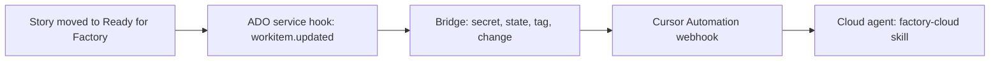

# Azure DevOps bridge for the cloud factory

A reference filter between an Azure DevOps service hook and a Cursor Automation webhook. `idefactory init` does not install it, and `idefactory` never creates Azure DevOps processes, fields, or hooks. Deploy it yourself on any HTTPS endpoint Azure DevOps can reach.



## 1. Azure DevOps process

On the User Story type of an inherited process:

| Item | Value |
| --- | --- |
| States | `Ready for Factory`, `In Progress`, `Waiting on Human`, `Blocked`, `In Review`, `Ready for Human Review` (plus the existing `New` and done states) |
| Field `Custom.OpenSpecChange` | String. The OpenSpec change name |
| Field `Custom.FactoryBranch` | String. Set by the factory to `factory/<change>` |
| Field `Custom.FactoryRunUrl` | String. Set by the factory to the cloud run URL |
| Tag | `factory` |

Use different names if you like, then record them with `idefactory board configure --state-ready "..." --change-field ...`.

## 2. Product repository

Run once in the product repository, then commit `.factory/config.json`:

```bash
idefactory board configure --organization https://dev.azure.com/<org> --project <project>
idefactory forge configure --provider azure-devops --organization https://dev.azure.com/<org> --project <project> --repository <repo>
```

After the GitHub migration, run `idefactory forge configure --provider github`. The board can stay on Azure DevOps.

For each change, a human authors the OpenSpec change, then:

```bash
idefactory sync-tasks <change>
idefactory board publish <change>
git add openspec .factory && git commit -m "Plan <change>" && git push
```

Moving the published story to `Ready for Factory` asks the factory to build that change.

## 3. Cursor Automation

1. Create an Automation with a **Webhook** trigger, repository set to the product repository, and **Run as** the team service account.
2. Add the Azure DevOps MCP as a tool for reads.
3. Add the runtime secret `ADO_TOKEN` to the environment: a PAT scoped to Work Items (read and write) and Code (read and write). Add `GH_TOKEN` too once the forge is GitHub.
4. The environment image needs the Azure CLI and its extension: `az extension add --name azure-devops`.
5. Save the Automation, then copy its webhook URL and generated bearer token.

Prompt:

```text
Follow the factory-cloud skill in this repository.
The webhook payload names workItemId, revision, and change.
Run the claim with this run's URL, and stop unless the decision is start or resume.
Open pull requests only with idefactory pr open. Never merge.
```

## 4. Bridge

Environment:

| Variable | Meaning |
| --- | --- |
| `ADO_HOOK_SECRET` | Random value. Azure DevOps sends it as the `x-factory-hook-secret` header |
| `CURSOR_AUTOMATION_URL` | The Automation webhook URL |
| `CURSOR_AUTOMATION_TOKEN` | The Automation bearer token |
| `FACTORY_READY_STATE`, `FACTORY_TAG`, `FACTORY_CHANGE_FIELD` | Optional overrides for the defaults above |

Azure Functions (Node, v4 programming model) wrapper:

```js
import { app } from '@azure/functions';
import { handle } from './index.mjs';

app.http('factoryBridge', {
  methods: ['POST'],
  authLevel: 'anonymous',
  handler: async (request) => {
    const result = await handle({ headers: request.headers, body: await request.text() }, process.env);
    return { status: result.status, body: result.body };
  },
});
```

`handle` takes `{ headers, body }`, so the same file works in a Cloudflare Worker or any Node server.

## 5. Service hook

Project settings, Service hooks, Web Hooks:

- Trigger: **Work item updated**, work item type User Story, optionally filtered to the `factory` tag.
- URL: the bridge endpoint.
- HTTP headers: `x-factory-hook-secret: <ADO_HOOK_SECRET>`.
- Resource details to send: **All**, so the revision carries the tag and change field.

The bridge returns `202` for edits it ignores and `200` when it forwards. A repeated delivery is harmless: `idefactory board claim` returns `duplicate` for a revision it already claimed.
